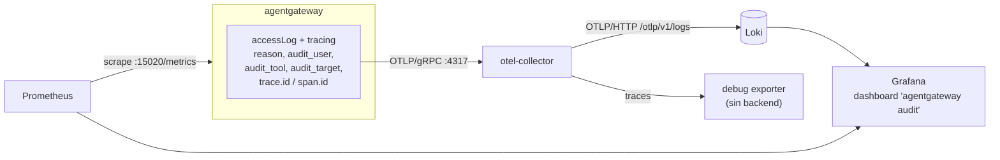
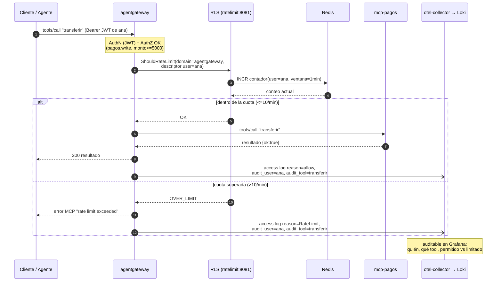
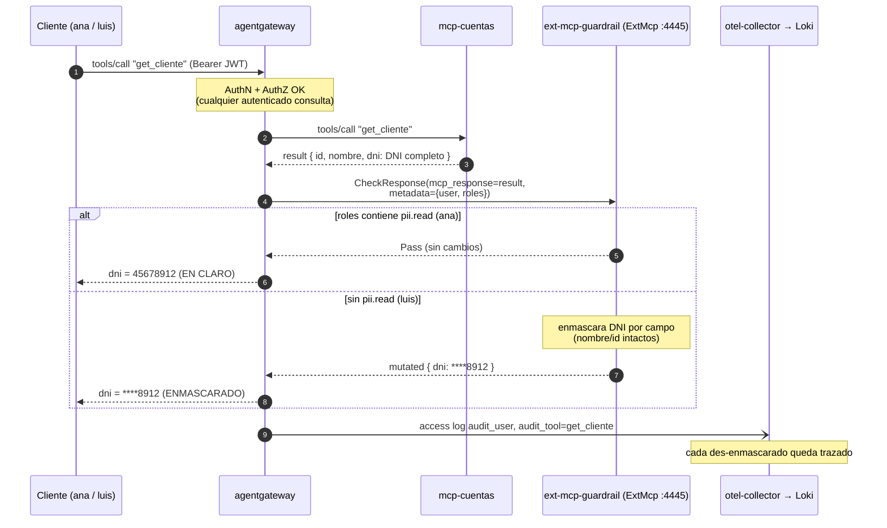

# Demo agentgateway — Diagramas

Diagramas de apoyo para los escenarios de **Rate limit** y **PII (guardrail)**, más la
**auditoría** que los acompaña a ambos. En Mermaid (se renderizan en GitHub/IDE).

Convención de red: el gateway comparte el *netns* de Keycloak, por eso `localhost:8080`
(Keycloak) lo alcanza directo, y a `ratelimit:8081`, `ext-mcp-guardrail:4445` y
`otel-collector:4317` los resuelve por DNS de la red por defecto.

---

## 0. Auditoría — el hilo que atraviesa todo

Cada request que pasa por el gateway produce **un access log** con la decisión
(`reason` = allow / Authorization / RateLimit) y campos enriquecidos (`audit_user`,
`audit_tool`, `audit_target`) + `trace.id`/`span.id`. Ese registro se exporta y termina
consultable en Grafana. **No hay Promtail ni socket de Docker**: el gateway empuja por OTLP.

Regla mnemotécnica: **métricas** = Prometheus (cuánto); **auditoría** = access logs → Loki
(qué/quién/por qué); **trazas** = OTLP → collector (correlación por `trace.id`).

---

## 1. Rate limit — "El cajero que se desboca"

Cuota **global por usuario** sobre `transferir`. Los contadores **no** viven en el gateway:
viven en el RLS (`envoyproxy/ratelimit`) respaldado por **Redis**, por eso la cuota es la
misma aunque haya N réplicas de gateway. `initialize` y otras tools **no** se limitan
(el `conditional` solo matchea `transferir`).

Puntos para narrar:
- El gateway **pregunta** al RLS (gRPC Envoy RLS); el RLS **cuenta** en Redis.
- `failureMode: failOpen` → si el RLS cae, la transferencia **pasa** (no se corta el negocio).
- Ambos desenlaces (OK y OVER_LIMIT) **se auditan** con el mismo `audit_user`/`audit_tool`.

---

## 2. PII — "El mismo dato, dos verdades"

El gateway envía la **respuesta** de cada `tools/call` a un guardrail externo (gRPC `ExtMcp`),
junto con la **identidad** del llamante (claims por CEL en `metadata`). El guardrail decide
en claro vs enmascarado **por contexto** y reescribe el resultado **por campo**.

Puntos para narrar:
- El dato sensible **nunca sale del perímetro** sin autorización; la decisión la toma el
  guardrail, no la app ni el MCP.
- `failureMode: failClosed` → si el guardrail cae, la respuesta **se rechaza** (no se filtra PII).
- El enmascarado es **por campo** (solo `dni`), y es **agnóstico al esquema** (recorre el
  JSON que venga). Un solo guardrail sirve a todo el gateway y ramifica por MCP si hace falta.
