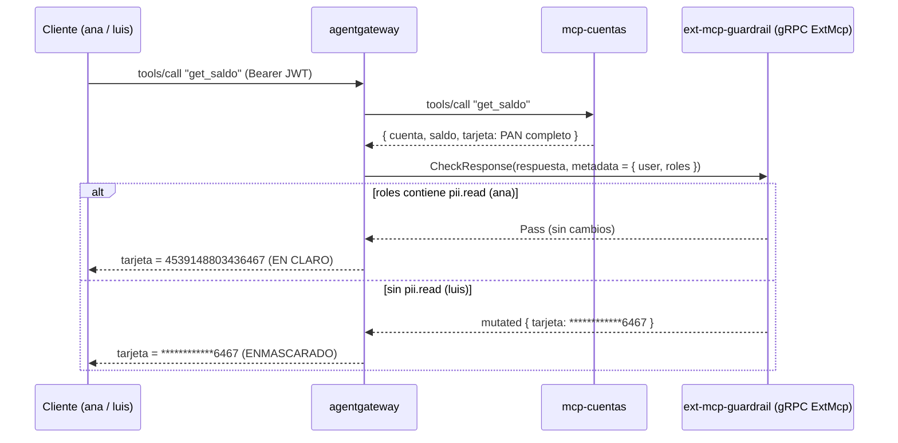
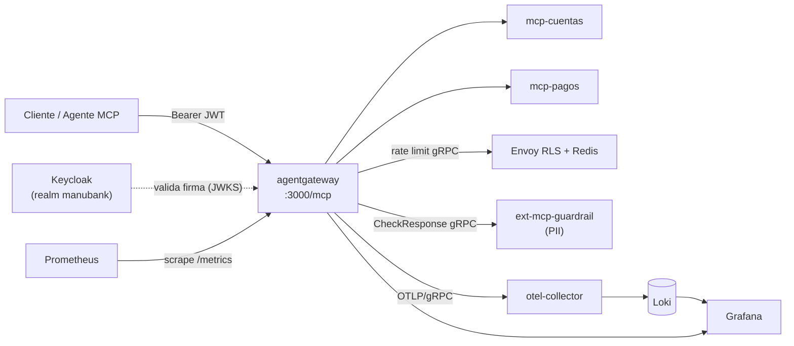

# agentgateway como MCP gateway — un solo perímetro para tus MCP

> PoC de **[agentgateway](https://agentgateway.dev)** como punto único de control delante de
> servidores MCP de un banco ficticio (**ManuBank**): autenticación, autorización por rol y por
> argumento, rate limit global, *tool filtering*, **enmascarado de PII por contexto** y auditoría.
> Ningún cliente habla con un MCP directamente: **todo pasa por el gateway**.


---

## ⭐ El feature estrella: el mismo dato, dos verdades (PII por contexto)

Ana (backoffice) y Luis (soporte) llaman **exactamente al mismo tool, sobre la misma cuenta**.
La respuesta trae un número de tarjeta completo (PAN). ¿Ven lo mismo? **No** — y la decisión no la
toma la app ni el MCP: la toma un **guardrail de contenido externo** al que el gateway le cuenta
*quién* pregunta.

```bash
./test-guardrail-pii.sh      # ana (claro) vs luis (enmascarado)
```

| Usuario | Rol `pii.read` | `cuentas_get_saldo` → campo `tarjeta` |
|---|:---:|---|
| **Ana**  | ✅ | `4539148803436467`  *(en claro)* |
| **Luis** | ❌ | `************6467`  *(enmascarado — solo últimos 4)* |

Y el enmascarado es **por campo**: `saldo` y `cuenta` quedan intactos en ambos casos. Solo se
redacta lo sensible.

### Por qué esto importa (el patrón, no el truco)



- **El MCP es tonto a propósito.** `mcp-cuentas` devuelve siempre el PAN sucio; no sabe nada de
  PII ni de roles. Toda la política de datos sensibles vive **fuera** del MCP.
- **La decisión es por contexto, no por endpoint.** El gateway le pasa la identidad al guardrail
  por CEL (`metadata: { roles, user }`). Mismo tool, misma data → resultado distinto según *quién*.
- **`failClosed`:** si el guardrail cae, la respuesta **se rechaza** — la PII no se filtra ante un fallo.
- **Escalable:** aquí el guardrail es un servicio de ~80 líneas en gRPC; mañana puede ser tu DLP
  corporativo, Amazon Macie o Microsoft Presidio. El gateway solo necesita el contrato `ExtMcp`.

> ⚠️ **Nota honesta de PoC:** el enmascarado es un regex ilustrativo (tapa secuencias largas de
> dígitos y deja los últimos 4). No es un detector de PII de producción — **el valor es el patrón
> de intercepción contextual en el perímetro**, no el detector en sí.

Diagrama y narrativa completos en **[`DEMO-DIAGRAMS.md`](DEMO-DIAGRAMS.md)** (§2) y
**[`DEMO-STORYTELLING.md`](DEMO-STORYTELLING.md)** (§4).

---

## Y además, el mismo perímetro hace todo esto

El PII es la estrella, pero el punto de fondo es que **un solo gateway** concentra todos los
controles con reglas declarativas. Cada historia tiene su script de prueba:

| # | Feature | Qué demuestra | Script |
|---|---|---|---|
| 1 | **AuthN + AuthZ por rol y por argumento** | JWT de Keycloak; catálogo de tools filtrado por identidad; transferencia bloqueada por monto (`> 5000` → `403`) | [`test.sh`](test.sh) |
| 2 | **Rate limit global por usuario** | Cuota exacta compartida (Envoy RLS + Redis), aplicada **solo** a `transferir`; consultas y `initialize` no se limitan | [`test-ratelimit.sh`](test-ratelimit.sh) |
| 3 | **Tool filtering** | `delete_account` existe en el MCP pero el gateway la oculta de `tools/list` y bloquea su llamada directa | [`test-tool-delete.sh`](test-tool-delete.sh) |
| ⭐ | **PII masking por contexto** | Mismo tool, PAN en claro para quien tiene `pii.read`, enmascarado para quien no | [`test-guardrail-pii.sh`](test-guardrail-pii.sh) |
| 5 | **Auditoría** | Cada decisión (allow / deny / ratelimit / mask) es un access log con `audit_user`/`audit_tool` y `trace.id`, exportado por OTLP → Loki → Grafana | ver §Observabilidad |

> El hilo conductor: **el control vive en el gateway**, no en el cliente ni en cada MCP. Un único
> sitio donde se autentica, autoriza, limita, filtra, enmascara y audita.

---

## Arquitectura



---

## Quickstart

**Requisitos:** Docker + Docker Compose, y `jq` para los scripts (`brew install jq`).

```bash
docker compose up --build        # levanta todo el stack
./test.sh                        # primer recorrido (usuario ana)
```

| Servicio | URL | Notas |
|---|---|---|
| Gateway MCP | http://localhost:3000/mcp | el único endpoint que usan los clientes |
| Admin UI | http://localhost:15000/ui | ⚠️ sin auth (solo PoC) |
| Keycloak | http://localhost:8080 | admin `admin` / `admin` |
| Prometheus | http://localhost:9090 | métricas |
| Grafana | http://localhost:3001 | login deshabilitado; dashboard **"agentgateway audit"** |

---

## Las demos, paso a paso

```bash
./test.sh                  # 1 · día normal: authN/Z por rol y por argumento
./test-ratelimit.sh        # 2 · rate limit: ráfaga de transferir → 🚫 pasado el umbral
./test-tool-delete.sh      # 3 · tool filtering: delete_account ni aparece ni se ejecuta
./test-guardrail-pii.sh    # ⭐ PII: ana (claro) vs luis (enmascarado)
```

Guion narrativo escena por escena en **[`DEMO-STORYTELLING.md`](DEMO-STORYTELLING.md)**.
Diagramas de secuencia en **[`DEMO-DIAGRAMS.md`](DEMO-DIAGRAMS.md)**.

---

## Usuarios de demo

| Usuario | Contraseña | Roles | Puede |
|---|---|---|---|
| **ana**  | `ana`  | `pagos.read`, `pagos.write`, `pii.read` | consultar, transferir (≤ 5000) y ver PII en claro |
| **luis** | `luis` | `pagos.read` | solo consultar; sin transferir ni PII en claro |

> ⚠️ **Credenciales de demo, no usar en producción.** El client `mcp-gateway` de Keycloak es
> **público + PKCE** (sin secreto). Ver **[`SECURITY.md`](SECURITY.md)**.

Para obtener un JWT a mano: `./get-jwt.sh ana -d` (imprime los claims decodificados).

---

## Estructura del repo

| Carpeta / archivo | Qué es |
|---|---|
| `agentgateway/config.yaml` | **el corazón**: authN, authZ, rate limit, tool filtering, guardrail y access logs, todo declarativo |
| `ext-mcp-guardrail/` | guardrail de PII externo (gRPC `ExtMcp`) — el feature estrella |
| `mcp-cuentas/`, `mcp-pagos/` | MCP custom en FastMCP (los targets detrás del gateway) |
| `keycloak/realm-manubank.json` | realm con usuarios, roles y el client `mcp-gateway` |
| `ratelimit/`, `prometheus/`, `grafana/`, `otel-collector/` | rate limit (Envoy RLS) y stack de observabilidad |
| `docker-compose.yml` | orquesta todo; config dentro de las imágenes (sin bind mounts) |
| `test*.sh`, `get-jwt.sh` | los scripts de demo |

---

## Observabilidad y auditoría

El gateway **empuja** los access logs por **OTLP/gRPC** a un OTel Collector → **Loki** (OTLP/HTTP);
Grafana los consulta (**sin Promtail ni socket de Docker**). Las métricas van por separado:
Prometheus scrapea `/metrics`.

- **Auditoría:** Grafana → dashboard **"agentgateway audit"** (`http://localhost:3001`).
- **En vivo:** `docker compose logs -f agentgateway`.

Cada request es una línea con la decisión en `reason` (`allow` / `Authorization` / `RateLimit`),
enriquecida con `audit_user`, `audit_tool`, `audit_target` y correlacionable por `trace.id`.
Diagrama del pipeline en **[`DEMO-DIAGRAMS.md`](DEMO-DIAGRAMS.md)** (§0).

---

## Conectar un cliente MCP

Cómo apuntar un cliente MCP real al gateway (y qué hacer con el diálogo de Client ID/secret):
**[`CLIENTE-MCP.md`](CLIENTE-MCP.md)**.

---

## Seguridad

Las concesiones conscientes de la PoC (admin sin auth, gRPC en claro, credenciales de demo, etc.)
están documentadas en **[`SECURITY.md`](SECURITY.md)**. **Esto es una PoC**, no un despliegue
endurecido para producción.

---

## Licencia

[MIT](LICENSE).
